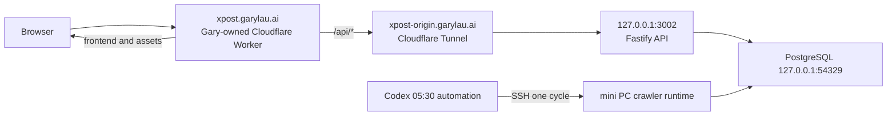

# Frontend hosting migration

Updated: 2026-08-22

## Decision and status

- OpenAI Sites is no longer the approved target host for x-post.
- The approved target is a vinext Cloudflare Worker deployed in Gary's own Cloudflare account.
- The public hostname remains `https://xpost.garylau.ai` and the public API remains same-origin at `/api/v1`.
- This decision is approved, but the migration is **not complete** until every cutover check below passes. Current production still points to `custom-domains.chatgpt.site` during the transition.
- Frontend changes, builds, Worker deployment, and hostname cutover run from `/Users/garylau/Work/x-post` on the Mac. The mini PC remains the PostgreSQL/API/crawler origin.

## Target architecture

The migration does not add a mini PC public listener, firewall rule, database container, hostname, or crawler scheduler. `xpost-origin.garylau.ai` remains the origin route to `127.0.0.1:3002`.

## Source changes

The current application is already a vinext Worker. Migration work should:

1. Remove `@openai/sites-vite-plugin` and the `sites()` Vite plugin.
2. Replace the Sites-owned hosting configuration with a project-owned Wrangler configuration.
3. Keep `worker/index.ts` as the frontend entry and keep its same-origin `/api/*` proxy.
4. Configure `XPOST_API_ORIGIN` through the Worker environment without committing secrets. The origin must remain HTTPS and credential-free.
5. Preserve the current frontend behavior, admin session cookies, media paths, and PNG export.

Do not delete `.openai/hosting.json` or detach the production Sites domain before the replacement Worker has passed temporary-host verification. Remove obsolete Sites configuration only as a scoped migration change with a recorded rollback source state.

## Migration sequence

1. Record local and remote Git status, the exact source SHA, current Sites custom-domain metadata, current public DNS answers, and current public/API health.
2. Reconcile Mac source with mini PC server-only changes. Do not overwrite crawler config, storage states, run artifacts, watermarks, database data, or unrelated worktree changes.
3. Implement the project-owned Worker configuration and run build, rendered HTML tests, server tests, lint, and `git diff --check`.
4. Deploy the replacement Worker to a temporary Worker hostname. Do not change `xpost.garylau.ai` yet.
5. On the temporary hostname, verify the homepage, current material count, authors, backgrounds/media, `/admin` unauthenticated response, authenticated admin flow, same-origin cookies, and PNG export.
6. Attach or route `xpost.garylau.ai` to the verified Worker. This production hostname change requires explicit user authorization at execution time.
7. Verify from at least two independent network exits, including one route that OpenAI Sites previously blocked. Confirm homepage and API are no longer served through `chatgpt.site`.
8. Keep the prior Sites attachment available during the observation window. Detach/decommission Sites only after the new Worker is healthy and the rollback path has been recorded.

## Cutover completion criteria

Migration is complete only when all of the following are true:

- `xpost.garylau.ai` serves the recorded self-managed Worker deployment and no longer resolves through or returns content from `custom-domains.chatgpt.site`.
- Homepage, assets, media, public materials API, admin authentication, authenticated writes, and PNG export pass.
- Public approved-material totals equal current PostgreSQL approved rows; per-author counts are reconciled without using a stale hard-coded baseline.
- mini PC loopback health and Tunnel origin health pass; no new public port or firewall rule exists.
- Mac and the previously blocked independent exit both return the expected application response instead of the Cloudflare `Attention Required` page.
- The deployed source SHA, Worker deployment identifier, DNS/route state, and rollback instructions are recorded without credentials.

## Rollback

If cutover verification fails:

1. Preserve the failed Worker deployment and its logs for diagnosis.
2. Restore the recorded Sites custom-domain attachment and DNS state.
3. Verify the old homepage and same-origin API before declaring rollback complete.
4. Do not roll back PostgreSQL migrations, crawler imports, material states, or watermarks as part of a frontend-hosting rollback.

Never treat a successful Worker upload, DNS propagation, or one working network exit alone as completion.
