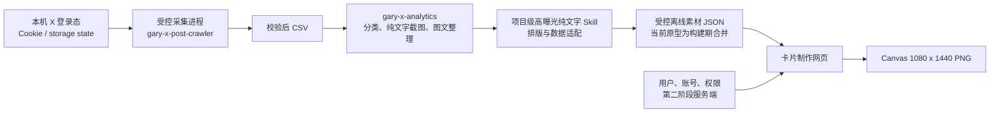

# 星际留白团队推文卡片工具：开发文档

更新日期：2026-08-18

## 1. 这次交付的解释

工单描述的是最终团队版，包含真实登录、服务端权限、数据库、后台和资源存储。当前用户请求把交付范围收敛为：

1. 先交付一个可运行网页，确认素材选择、账号切换、卡片制作和导出体验。
2. 复用现有 X 抓取、纯文字提取、分类和“截图 + 风景背景”能力。
3. 为以后使用用户自己的 Cookie 补充素材库预留安全接口，但这一版不读取 Cookie。
4. 暂不自动上线，暂不打包进星际留白 App。

因此当前实现是“交互完整的本地原型 + 可迁移数据契约”，不是伪装成生产系统的前端权限。

## 2. 当前已实现

### 制作台

- 浏览、搜索和按分类筛选团队推文。
- 默认载入 rwayne 的 101 条、黄小木的 21 条纯文字贴文，共 122 条；其他来源和图文贴文不进入素材库。
- 浏览器不提供贴文导入入口。受控离线同步只接收 rwayne、黄小木严格校验后的纯文字记录；带媒体字段、图文集合或其他来源会被过滤。正文不执行清洗或重写，原始段落、空行、手动换行、连续空格、标点和链接会原样保留。
- 选择任意来源推文，再独立选择有权限的发布账号。
- 切换账号时同步头像、名称、ID、认证标志和名称标签。rwayne 与黄小木使用现有 X 原始截图中提取的真实头像，网页预览和 PNG 导出共用同一份本地头像资源。
- 编辑正文或恢复原推。
- 选择 10 张城市与风景背景（4 张既有素材与 6 张 1080 × 1440 精选图）、上传本地背景、添加网络背景；新增素材的原图页面和许可记录见 `docs/背景素材来源.md`。
- 调整背景压暗；X 卡片使用固定 598px 外框、566px 正文宽度、15px 正文和 20px 行高，正文内容仍可编辑。默认将整张卡片等比缩放到海报宽度约 72%，预览与 PNG 导出保持一致；缩放不触发重新换行。
- 预览采用固定 1080 × 1440 像素画布，背景图与推文卡片都处在同一画布坐标系内。页面栏宽或视口尺寸变化时只整体缩放画布的显示比例，不改变背景裁切、卡片比例、卡片位置或最终导出像素。
- 在预览中拖动卡片位置，并通过右下角不可见热区对整张卡片等比缩放；不再使用可见的方形按钮或单独宽度缩放。缩放上限只由固定画布的完整宽高决定，不再按卡片当前位置或预设倍率提前限制；卡片可一直放大到贴住画布边缘，但四边不能越过 3:4 外部底图。
- 内部卡片采用现有素材截图结构：头像、账号名、ID、认证、省略号、常规字重正文、日期/浏览量、分隔线，以及回复、转推、点赞、书签、分享五个矢量图标。回复、转推、点赞和书签始终显示数据；源数据缺失时显示 0。五个图标路径直接取自 X 原帖页面当前渲染的内联 SVG；网页预览与 Canvas 导出复用同一套填充路径、尺寸和顺序。
- 左侧素材候选卡显示浏览、回复、转推、点赞和书签五项公开数据，选择素材前即可比较表现。
- 候选卡的五项数据强制保持单行。选择素材时，浏览、回复、转推、点赞和书签作为默认值载入制作台；右侧可逐项修改当前卡片数据，修改同步作用于网页预览和 PNG，不回写素材库原始记录。
- 页面容器、预览海报、推文卡片和 Canvas 导出均采用直角版式。
- 预览海报不显示 `BLANKSPACE · TEAM EDITION` 或其他底部团队水印。
- 生成并复制“正文 + 当前账号名称标签”。
- 用 Canvas API 生成 1080 × 1440 PNG。

### 推文库

- 统一展示正文、来源、标签、分类、日期和原链接；左侧素材卡与推文库表格都可在新标签页打开 X 原贴。
- 来源只记录素材归属，不限制发布账号。
- 从列表可直接回到制作台。

### 明确未实现

- 真实登录、会话、数据库和管理员后台 CRUD。
- 服务端账号权限判断与审计日志。
- 图片对象存储。
- 浏览器内使用 Cookie 运行 X 抓取；真实采集只允许由项目级离线 Skill 调用受控采集进程。
- 自动发布到 X 或其他平台。
- 生产部署与星际留白 App 打包。

## 3. 技术结构



当前代码采用 Vinext / React / TypeScript。网页状态先保存在内存中，未来把素材、账号、权限和背景列表替换为 API 数据，不需要推倒制作器。

当前默认素材由 `scripts/build-existing-materials.mjs` 生成：它读取相邻 `Social` 工作区的公开素材清单，并合并 `app/data/crawled-high-exposure-materials.json`，输出 `app/data/existing-materials.json`。黄小木的回复、转推、点赞和书签优先读取结构化截图清单；rwayne 的相同四项从现有 X 截图底部通过本机 Vision OCR 提取。生成结果不包含 Cookie、凭据、截图绝对路径或媒体源文件路径。

由于部分旧清单已经把原帖换行压平，同步器会逐条读取 117 张留存的 X 原始截图，用 Vision OCR 提取正文的可见行断点，再通过字符序列对齐把这些断点映射回清单原文。清单仍是字词、空格和标点的唯一来源，OCR 只决定在哪里换行；匹配覆盖率不足时会保留清单原文而不猜测。新抓取记录则直接使用 crawler 保留的段落、空行和手动换行。

```bash
npm run data:sync
npm run data:high-exposure
```

当前 122 条默认素材分布：rwayne 101 条、黄小木 21 条。其中 117 条来自既有 `pure_text_posts`，5 条来自本次严格抓取并完成语义分类的高曝光纯文字原创帖。发布授权账号只输出黄小木与 Roland.W 到 `app/data/existing-accounts.json`；5 个团队用户及其有限账号关系仍输出到 `app/data/existing-users.json`。背景库共 10 张城市与风景图，统一放在 `public/backgrounds/`：保留 4 张既有素材，并新增 6 张统一为 1080 × 1440 的精选图，包含两张晴日仰拍、两张落日城市素材与两张雪峰风景。网页和 Canvas 导出都通过同源路径读取。

## 4. 现有 X 工具的复用方式

项目内入口是 `.agents/skills/x-high-exposure-pure-text/`。它不复制上游代码或登录态，只按顺序执行 `gary-x-post-crawler` 的计划、抓取、严格验证，再把最终 CSV 交给 `gary-x-analytics` 的 `analyze_csv.py`。默认阈值为 `Impressions > 100000`。

### 4.1 X 抓取

使用 `gary-x-post-crawler`。它输出的 CSV 已包含网页导入所需的主要列：

- `Post id`
- `Date` / `Published at`
- `Post text`
- `Post Link`
- `Media URLs`
- `Impressions`、`Replies`、`Reposts`、`Likes`
- `Author`

进入团队素材库前继续遵守现有严格门：

- 目标作者一致。
- `Original verification = verified_original`。
- 不是回复帖。
- 覆盖不完整时允许导入已验证记录，但不能把采集水位推进为完整。
- Cookie / storage state 不随 CSV 进入本项目。

### 4.2 纯文字、图文和分类

使用 `gary-x-analytics`：

- `analyze_csv.py` 从 CSV 先分出 `pure_text`、`image_text`、`excluded`。
- `collect_image_text_http.py` 通过 HTTP / oEmbed 整理图文正文和媒体。
- `screenshot_posts.mjs` 为纯文字帖生成正文截图。
- `classify_pure_text_screenshots.py` 生成分类任务并整理截图。
- `merge_collection.py` 生成 `collection_manifest.json`。
- `compose_pure_text_materials.py` 将纯文字截图等比放到 1080 × 1440 风景图上。

离线同步链可以读取下列输入格式，但最终只保留 rwayne 与黄小木的纯文字记录；网页端不提供贴文文件导入入口：

- crawler CSV；
- analytics 的纯文字候选 JSON；
- `collection_manifest.json`；
- `gary-content-batch/v1` 风格的 `items.jsonl`。

Social 工作区保留的是更早的运营脚本和运行历史；上述可复用制作链已经整理到 `gary-x-skills`，新网页以它为权威接口，避免复制两套逻辑。

### 4.3 2026-08-18 本次同步结果

- `rwayne`：从原水位线补抓到 2026-08-19 排他边界，1,511 条原始记录中 1,509 条通过 `verified_original`，1 条回复和 1 条验证错误进入隔离；覆盖完整，水位线安全推进。分析得到 33 条十万曝光以上帖子，其中 5 条为纯文字，已完成语义分类并加入网页。
- `ai_xiaomu`：X 日期搜索在历史窗口持续报错，近期开窗拿到的 79 条记录全部通过严格原创验证，日期覆盖 2026-08-13 至 2026-08-18；其中 3 条十万曝光以上帖子都带媒体，纯文字新增为 0。该作者仍保留原素材库 21 条高曝光纯文字帖。本次结果明确标记为局部覆盖，没有创建或推进黄小木水位线。

局部覆盖不等于“黄小木近 90 天没有其他高曝光纯文字帖”。后续刷新必须从未覆盖边界补抓，不得把这次 79 条样本当成完整历史。

## 5. 离线素材同步契约

最小记录：

```json
{
  "post_id": "1840000000000000000",
  "original_text": "推文正文",
  "source": "素材来源人",
  "published_at": "2026-08-18T10:00:00+08:00",
  "link": "https://x.com/example/status/1840000000000000000",
  "category": "AI工具",
  "tags": ["AI工具", "团队效率"],
  "note": "可选备注",
  "impressions": 68000,
  "replies": 23,
  "reposts": 128,
  "likes": 946
}
```

离线同步层兼容下列现有别名：

| 规范字段 | 兼容输入 |
|---|---|
| `post_id` | `Post id`、`id` |
| `original_text` | `Post text`、`text`、`extracted_text`、`csv_text` |
| `source` | `source_author`、`Verified author`、`author` |
| `published_at` | `date_iso`、`Date`、`date` |
| `link` | `Post Link`、`source_url` |
| `impressions` | `impressions_number`、`Impressions`、`views` |

JSON 顶层可以是数组，或使用 `items`、`posts`、`confirmed`、`pure_text_posts`。若集合包含 `image_text_posts`，该集合不会进入网页素材。CSV 支持带引号和换行的标准字段。来源字段接受 rwayne、Roland.W、@rwayne、黄小木、ai_xiaomu、@ai_xiaomu；其余来源会被过滤。存在非空媒体、图片或视频字段的记录也会被过滤。指标字段同时兼容 `Replies` / `replies`、`Reposts` / `reposts`、`Likes` / `likes`、`Bookmarks` / `bookmarks`。

## 6. 第二阶段数据模型

建议最小表：

| 表 | 关键字段 | 说明 |
|---|---|---|
| `users` | id, name, email, role, status | 团队成员和管理员 |
| `publishing_accounts` | id, name, handle, avatar_key, verified, name_tag, enabled | 发布身份 |
| `user_account_permissions` | user_id, account_id, granted_by, granted_at | 服务端授权关系 |
| `tweets` | id, text, source_name, source_url, published_at, category, tags, note | 团队共享素材 |
| `tweet_media` | tweet_id, object_key, media_type, order_index, source_url | 媒体与来源 |
| `backgrounds` | id, object_key, title, status, created_by | 背景资源 |
| `card_drafts` | tweet_id, account_id, body, background_id, settings_json | 可恢复草稿 |
| `audit_logs` | actor_id, action, entity_type, entity_id, metadata, created_at | 管理操作记录 |

关键关系：

- `tweets` 不包含 `publishing_account_id`。
- 草稿或导出记录才同时引用素材和发布账号。
- 查询可用账号时必须由服务端按 `user_account_permissions` 过滤。
- 前端隐藏账号只是体验，不能作为安全边界。

## 7. 第二阶段 API 草案

```text
POST   /api/session/login
GET    /api/me
GET    /api/me/publishing-accounts
GET    /api/tweets
POST   /api/tweets
PATCH  /api/tweets/:id
DELETE /api/tweets/:id
GET    /api/backgrounds
POST   /api/backgrounds/upload-url
POST   /api/card-drafts
GET    /api/admin/users
PUT    /api/admin/users/:id/account-permissions
GET    /api/admin/audit-logs
POST   /api/internal/x-imports
```

`/api/internal/x-imports` 只接受后端服务身份或本机受控同步器，不接受浏览器提交 Cookie。

## 8. Cookie 与素材库补充

正确边界：

1. Cookie 或 Playwright storage state 只保存在用户控制的本机或受控服务器，权限设为 owner-only。
2. 采集器在同一受控环境里调用 `gary-x-post-crawler`。
3. 校验器剔除回复、错作者和未验证记录，并保留覆盖状态。
4. 适配器把通过门禁的素材转换成上面的导入契约。
5. 只有正文、来源、公开链接、公开指标和经授权媒体进入团队库。
6. 网页永远拿不到 Cookie、Authorization 头或浏览器存储。

不要做：

- 不把 Cookie 放进 `.env.example`、前端环境变量、LocalStorage 或导入 JSON。
- 不让浏览器直接用 Cookie 请求 X。
- 不把 Cookie 写进日志、截图、错误报告或数据库审计元数据。

## 9. PNG 生成策略

当前采用浏览器 Canvas，而不是截取 DOM：

- 输出尺寸固定 1080 × 1440。
- 既有城市背景从 `public/backgrounds/` 同源读取，内置渐变用 Canvas 重绘。
- 上传背景用对象 URL 读取并按 cover 规则裁切。
- 文本按实际字体测量逐字换行。
- 账号身份、认证标志和互动数由同一状态绘制。
- 导出前按卡片模板的实际行数重新计算完整高度，并以海报四周安全边距为上限限制缩放和坐标；即使预览状态异常，PNG 中的内部卡片也不会超出 1080 × 1440 底图。

已知限制：网络图片若没有允许跨域读取的 CORS 响应，浏览器可以预览，但不能安全导出 Canvas。正式版建议先由服务端下载、验证类型与大小、存入对象存储，再返回同源 URL。

## 10. 开发顺序

### 阶段 1：当前网页

- [x] 初始化项目和本地运行环境。
- [x] 制作台和素材库；团队设置页已按当前产品范围删除。
- [x] 受控离线素材同步；网页端不提供贴文文件导入。
- [x] 账号同步、背景控制、拖动、复制、PNG。
- [x] rwayne 与黄小木的 122 条纯文字素材及 10 张城市与风景背景默认入库，其他贴文素材来源和图文记录全部排除；AI 内容细分为 AI工具、AI效率、AI实操、AI世界观、AI认知、AI商业、AI学习，非 AI 内容保留原分类，网页只显示实际分类。
- [x] 项目级高曝光纯文字 Skill、严格抓取/筛选适配器和构建期合并脚本。
- [x] 发布账号只保留黄小木与 Roland.W。
- [x] 卡片本体右下角等比缩放、X 截图式内部排版，所有矩形界面与导出卡片保持直角。
- [x] 响应式布局。
- [ ] Gary 人工调整视觉、卡片模板和默认账号资料。

### 阶段 2：真实团队版

- [ ] 登录与角色。
- [ ] 数据库和对象存储。
- [ ] 素材、账号、背景、用户的管理后台。
- [ ] 服务端账号权限。
- [ ] 素材同步器和导入审计。
- [ ] 操作日志、备份和恢复。

### 阶段 3：星际留白 App

- [ ] 确认 App 的 WebView / 微前端 / 原生壳技术。
- [ ] 复用统一身份和会话。
- [ ] 把图片上传、下载、分享适配为 App 能力。
- [ ] 再决定网页独立部署还是随 App 打包。

## 11. 验收与测试

自动验证：

```bash
pnpm lint
pnpm build
pnpm test
```

人工验收清单：

1. 从两个来源素材中选择任意一条，检查候选卡五项数据与 X 原贴链接。
2. 切换两个已授权发布账号，检查身份和名称标签同步；选择素材时默认匹配其来源账号。
3. 编辑正文、恢复原推，并拖动右下角热区等比改变整张卡片大小；字号保持固定。
4. 拖动卡片位置并调暗背景。
5. 上传 JPG / PNG / WebP 背景。
6. 运行项目级 Skill 与 `data:high-exposure`，确认只有严格原创纯文字帖进入网页。
7. 复制发布文案。
8. 下载 PNG，确认尺寸为 1080 × 1440。

## 12. 已知问题

- 刷新页面会恢复模拟数据和权限；当前没有持久化。
- 上传的背景只在当前浏览器会话可用。
- 网络背景受 CORS 限制。
- PNG 使用系统字体，不同系统可能有轻微排版差异。
- 当前没有独立头像原图，已导入账号仍使用文字头像；名称、ID 与认证状态来自现有公开资料。
- 当前 122 条纯文字素材优先合并采集 JSON、截图清单或严格 crawler CSV 中的回复、转发、点赞、书签与浏览量；源数据缺失时显示 0，不制造互动数据。
- 当前没有真实管理员操作日志。
- 当前只做单卡片模板，后续可增加模板版本，而不是把样式硬编码进账号。
