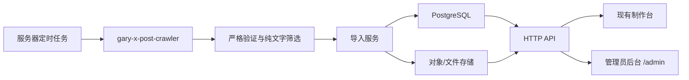

# 星际留白推文卡片工具：服务器端开发与部署清单

更新日期：2026-08-20

本文档用于交给另一个具备目标服务器 SSH 权限、并受目标项目部署规则约束的 AI Agent 执行。它描述交付目标、技术边界、开发任务、迁移顺序、部署步骤和验收标准；它本身不授权访问任何未声明的服务器路径、复制 Cookie、修改 DNS、开放防火墙、删除旧数据或替换线上服务。

## 0. 执行前必须确认

执行 Agent 开始修改前必须完成以下只读检查，并把结果记录到部署日志：

- [ ] 读取目标服务器项目根目录及更近目录的全部 `AGENTS.md`、部署规则和回滚规则。
- [ ] 明确本地项目根目录 `LOCAL_PROJECT_ROOT`，不得把本机 `/Users/garylau/Work/x-post` 当作服务器路径。
- [ ] 明确 `REMOTE_PROJECT_ROOT`：服务器端代码目录。
- [ ] 明确 `REMOTE_DATA_ROOT`：PostgreSQL 数据、媒体文件和抓取运行状态的持久化目录。
- [ ] 明确 `REMOTE_BACKUP_ROOT`：数据库与媒体备份目录。
- [ ] 建立 `REMOTE_ALLOWED_PATHS`，逐项标记 `R` 或 `RW`。未列入的远端路径禁止访问。
- [ ] 确认 SSH 主机、SSH 用户、CPU 架构、Linux 发行版、可用磁盘、内存、时区和现有反向代理。
- [ ] 确认服务器是否已有 Docker/Podman、PostgreSQL、Caddy/Nginx、Node.js 22 和 Playwright 运行依赖。
- [ ] 确认线上前端仍部署在当前 Sites/Cloudflare 项目，还是本次也迁入服务器。默认方案为“前端保持现状，服务器新增 API、数据库和爬虫”。
- [ ] 确认 API 域名。建议 `api.xpost.garylau.ai`；DNS 和证书变更必须另有明确授权。
- [ ] 确认管理员登录方式。建议 OIDC 登录并使用管理员邮箱 allowlist，不自建弱密码系统。
- [ ] 确认备份保留周期和备份落点；默认至少保留每日 7 份、每周 4 份。
- [ ] 只检查集中式密钥中“变量名是否存在”，不得输出变量值或完整 `.env`。

任何一项无法确认时，Agent 应停在方案或本地实现阶段，不得猜测远端路径、DNS、端口、用户身份或凭据位置。

## 1. 最终交付目标

完成后应具备以下能力：

1. 当前卡片制作台继续可用，拖动、等比缩放、固定 X 排版、正文编辑、数据编辑、背景选择和 1080 × 1440 PNG 导出行为不变。
2. 素材不再依赖编译进前端的 `app/data/*.json`，而是从服务器 API 分页读取。
3. 现有 329 条纯文字素材、发布账号、作者头像和背景素材迁移到服务器持久化存储。
4. 服务器按计划自动运行 X 抓取、严格原创验证、纯文字筛选、分类、去重和数据更新。
5. Cookie / Playwright storage state 只存在于受控服务器，不进入网页、API 响应、数据库业务表、日志、Git 或备份清单。
6. 新抓取素材默认进入待审核队列；管理员审核通过后才出现在制作台。
7. 管理员后台可以管理素材、分类、作者、发布账号、背景、抓取任务、失败记录和审计日志。
8. 部署可回滚，数据库有备份，导入和抓取任务幂等，不会重复创建素材。
9. 当前 `xpost.garylau.ai` 的公开访问和 PNG 制作不因后台升级中断。

## 2. 推荐架构

默认采用渐进式混合架构，先不迁移当前前端托管：



推荐组件：

| 组件 | 推荐实现 | 说明 |
|---|---|---|
| 前端 | 保留现有 Vinext / React 页面 | 第一阶段继续部署在现有 Sites/Cloudflare 项目 |
| API | Node.js 22 + TypeScript；优先复用目标服务器项目现有框架，否则使用 Fastify | 提供公开只读接口、管理员接口和内部导入接口 |
| 数据库 | PostgreSQL 16+ | 保存素材、账号、权限、任务、水位和审计日志 |
| ORM/迁移 | Drizzle ORM + SQL migration | 当前仓库已有 Drizzle 依赖，可延续现有技术栈 |
| 图片存储 | S3 兼容对象存储，或服务器持久化文件目录加存储适配层 | 保存背景、头像；不得将 Cookie 当作媒体上传 |
| 抓取 Worker | 独立 Node/Python 进程 | 调用项目指定的 `gary-x-post-crawler` 与分析工具 |
| 调度 | systemd timer、目标项目既有调度器，或单独 scheduler 容器 | 必须带互斥锁、超时和可审计运行记录 |
| 反向代理 | 复用服务器现有 Caddy/Nginx | TLS、限流、请求大小限制和安全头 |
| 管理员认证 | OIDC + 明确邮箱 allowlist | 不建议自己保存管理员密码 |

第一阶段不要求 Redis。抓取任务量不大时，使用 PostgreSQL 任务表和 advisory lock 足够；只有出现多 Worker、复杂重试和大量异步任务后再引入队列系统。

## 3. 仓库与目录建议

若服务器项目没有既定结构，建议在其 `REMOTE_PROJECT_ROOT` 内组织为：

```text
apps/
  api/                    # API 与管理员鉴权
  crawler-worker/         # X 抓取、验证、分类和导入
packages/
  contracts/              # API 类型、Zod schema、枚举
  database/               # Drizzle schema、migration、seed
  material-pipeline/      # 纯文字门禁、去重、分类、导入适配
deploy/
  compose.yaml            # 如果目标项目采用容器部署
  systemd/                # 如果目标项目采用 systemd
  caddy/ or nginx/        # 只放模板，不放证书或密钥
scripts/
  migrate-existing-data.*
  backup.*
  restore-smoke-test.*
docs/
  deployment.md
  operations.md
  rollback.md
```

服务器持久化数据必须位于已声明的 `REMOTE_DATA_ROOT`，不能埋在 Git checkout 中。建议逻辑结构：

```text
REMOTE_DATA_ROOT/
  postgres/
  media/
    backgrounds/
    avatars/
  crawler/
    storage-states/
    runs/
    quarantine/
  exports/
```

要求：

- [ ] `storage-states/` owner-only，目录权限 `700`，文件权限 `600`。
- [ ] API 进程无权读取 `storage-states/`；只有 crawler Worker 身份可以读取。
- [ ] PostgreSQL、媒体和 crawler 状态分别挂载持久化卷。
- [ ] Git、构建上下文和静态文件服务明确排除 `REMOTE_DATA_ROOT`。
- [ ] 日志只记录路径标识、任务 ID 和脱敏错误，不打印请求 Cookie、Authorization 或 storage state。

## 4. 数据库开发清单

### 4.1 用户与权限

- [ ] `users`
  - `id uuid primary key`
  - `email citext unique not null`
  - `display_name text`
  - `role enum('admin','editor','viewer')`
  - `status enum('active','disabled')`
  - `created_at`、`updated_at`、`last_login_at`
- [ ] `auth_identities`
  - `user_id`
  - `provider`
  - `provider_subject`
  - `(provider, provider_subject)` 唯一
- [ ] `publishing_accounts`
  - `id uuid`
  - `name`、`handle`、`avatar_object_key`
  - `verified`、`name_tag`、`enabled`
  - `source_profile_url`
- [ ] `user_account_permissions`
  - `user_id`、`publishing_account_id`
  - `granted_by`、`granted_at`
  - 联合唯一键，所有授权检查在服务端执行

### 4.2 作者与素材

- [ ] `source_authors`
  - `id uuid`
  - `platform enum('x')`
  - `handle citext`
  - `display_name`
  - `profile_url`
  - `avatar_object_key`
  - `enabled`
  - `minimum_impressions bigint default 5000`
  - `(platform, handle)` 唯一
- [ ] `materials`
  - `id uuid primary key`
  - `platform enum('x')`
  - `platform_post_id text not null`
  - `source_author_id uuid not null`
  - `source_url text not null`
  - `original_text text not null`
  - `published_at timestamptz not null`
  - `content_type enum('pure_text','image_text','video','link','other')`
  - `category text not null`
  - `tags text[] not null default '{}'`
  - `admin_note text`
  - `status enum('pending','approved','rejected','archived')`
  - `rejection_reason text`
  - `verified_original boolean not null`
  - `content_hash text not null`
  - `first_seen_run_id uuid`
  - `last_seen_run_id uuid`
  - `approved_by`、`approved_at`
  - `created_at`、`updated_at`、`deleted_at`
  - `(platform, platform_post_id)` 唯一
- [ ] `material_metrics`
  - `material_id uuid`
  - `views bigint`、`replies bigint`、`reposts bigint`、`likes bigint`、`bookmarks bigint`
  - `observed_at timestamptz`
  - `(material_id, observed_at)` 唯一
- [ ] `material_current_metrics`
  - 可以是物化字段、视图或单独表；API 必须高效返回每条素材最新五项数据。
- [ ] `material_raw_snapshots`
  - 保存允许留存的公开抓取字段、schema 版本和 payload hash。
  - 严禁保存 Cookie、Authorization、storage state 或完整浏览器网络头。

必须保证 `original_text` 原样保存 `\n`、空行、连续空格和标点。任何 HTML 转义只在输出层处理，数据库不得为了展示方便压平正文。

### 4.3 背景、草稿和导出

- [ ] `backgrounds`
  - `id uuid`
  - `title`、`object_key`、`mime_type`、`width`、`height`、`sha256`
  - `source_url`、`license_note`
  - `status enum('active','disabled')`
  - `created_by`、`created_at`
- [ ] `card_drafts`
  - `user_id`、`material_id`、`publishing_account_id`、`background_id`
  - `body`、`metrics_override jsonb`、`settings_json jsonb`
  - `version integer`，用于乐观锁
- [ ] `exports`
  - 记录谁在何时基于哪个素材和账号导出；默认只保存元数据，不强制保存 PNG。
- [ ] 如果保存 PNG，必须设置生命周期和配额，避免对象存储无限增长。

### 4.4 抓取、水位和审计

- [ ] `crawl_runs`
  - `id uuid`
  - `source_author_id`
  - `requested_since`、`requested_until`
  - `started_at`、`finished_at`
  - `status enum('planned','running','partial','succeeded','failed','cancelled')`
  - `coverage_complete boolean`
  - `profile_fallback_used boolean`
  - `raw_count`、`verified_count`、`pure_text_count`、`imported_count`、`updated_count`、`quarantined_count`
  - `error_summary`、`artifact_manifest_path`
- [ ] `crawl_watermarks`
  - 每个作者一个连续覆盖边界和最后成功任务 ID。
  - 只有 `coverage_complete=true` 且严格验证完成时才允许推进。
- [ ] `crawl_quarantine`
  - 保存验证失败、正文截断、作者不符、回复、引用、媒体贴和链接贴的原因及公开标识。
- [ ] `audit_logs`
  - `actor_type enum('user','service')`
  - `actor_id`、`action`、`entity_type`、`entity_id`
  - `metadata jsonb`、`created_at`
  - metadata 不得包含密钥或 Cookie。

### 4.5 索引和约束

- [ ] `materials(platform, platform_post_id)` 唯一索引。
- [ ] `materials(status, published_at desc)`。
- [ ] `materials(source_author_id, status, published_at desc)`。
- [ ] `materials(category, status, published_at desc)`。
- [ ] 正文搜索采用 PostgreSQL `pg_trgm` 或中文分词方案；第一阶段可用 trigram。
- [ ] 所有指标字段约束为 `>= 0`。
- [ ] `source_url` 必须匹配允许的 X 状态链接格式。
- [ ] `content_type='pure_text'` 且 `status='approved'` 才能进入制作台默认查询。
- [ ] 删除默认使用软删除；永久删除必须是单独高权限操作并写审计日志。

## 5. API 开发清单

统一使用 `/api/v1`，返回 JSON，错误格式固定：

```json
{
  "error": {
    "code": "MATERIAL_NOT_FOUND",
    "message": "Material not found",
    "requestId": "..."
  }
}
```

### 5.1 公开/制作台接口

- [ ] `GET /api/v1/materials`
  - 参数：`cursor`、`limit`、`author`、`category`、`q`、`sort`。
  - 只返回 `approved + pure_text + 未软删除`。
  - 默认按浏览量或发布时间排序；明确稳定的 cursor 规则。
  - 返回最新五项互动数据和原贴链接。
- [ ] `GET /api/v1/materials/:id`
- [ ] `GET /api/v1/source-authors`
- [ ] `GET /api/v1/publishing-accounts`
  - 登录用户存在时按服务端权限过滤。
- [ ] `GET /api/v1/backgrounds`
- [ ] `POST /api/v1/card-drafts`
- [ ] `PATCH /api/v1/card-drafts/:id`
- [ ] `GET /api/v1/card-drafts/:id`
- [ ] 为公开列表配置合理缓存；管理员修改素材后要主动失效或使用短 TTL。

### 5.2 管理员接口

- [ ] `GET /api/v1/admin/materials`
  - 支持状态、作者、分类、日期、抓取任务、排除原因筛选。
- [ ] `POST /api/v1/admin/materials`
  - 用于人工创建；同样执行 URL、纯文字和去重校验。
- [ ] `PATCH /api/v1/admin/materials/:id`
- [ ] `POST /api/v1/admin/materials/:id/approve`
- [ ] `POST /api/v1/admin/materials/:id/reject`
- [ ] `POST /api/v1/admin/materials/bulk-update`
- [ ] `DELETE /api/v1/admin/materials/:id`
  - 默认软删除。
- [ ] `GET/POST/PATCH /api/v1/admin/source-authors`
- [ ] `GET/POST/PATCH /api/v1/admin/publishing-accounts`
- [ ] `GET/POST/PATCH/DELETE /api/v1/admin/backgrounds`
- [ ] `GET /api/v1/admin/crawl-runs`
- [ ] `GET /api/v1/admin/crawl-runs/:id`
- [ ] `POST /api/v1/admin/crawl-runs`
  - 仅创建任务，不在 HTTP 请求内同步跑完整爬虫。
- [ ] `POST /api/v1/admin/crawl-runs/:id/retry`
- [ ] `GET /api/v1/admin/audit-logs`
- [ ] 所有管理员写操作写入 `audit_logs`。

### 5.3 内部导入接口

- [ ] `POST /api/v1/internal/x-imports`
  - 仅 crawler Worker 服务身份可调用。
  - 使用短期服务凭据、mTLS 或目标项目既有的服务认证方式。
  - 支持 `Idempotency-Key`。
  - 一个导入批次必须在事务中完成。
  - 以 `(platform, platform_post_id)` upsert。
  - 正文变化时保留变更前摘要或版本记录，不能静默覆盖人工编辑。
  - 指标按 `observed_at` 追加快照，并更新当前指标。
- [ ] `POST /api/v1/internal/crawl-runs/:id/complete`
  - 服务端二次检查覆盖状态后才推进水位。
- [ ] 请求体大小、速率和来源 IP 按目标部署规则限制。

### 5.4 健康与可观测性

- [ ] `GET /health/live`：进程存活，不依赖外部服务。
- [ ] `GET /health/ready`：检查数据库、迁移版本和对象存储。
- [ ] 每个请求生成 `requestId`。
- [ ] 结构化日志包含时间、级别、服务、requestId、任务 ID，不包含敏感信息。
- [ ] 记录 API 延迟、错误率、抓取成功率、待审核数量和最后成功抓取时间。

## 6. X 自动抓取与同步清单

必须使用项目指定的 `gary-x-post-crawler`，不得用手工浏览、可见 Chrome 时间线或新的非严格脚本替代正式结果。

### 6.1 当前作者与门禁

初始作者：

- [ ] `rwayne`
- [ ] `ai_xiaomu`
- [ ] `dashen_wang`
- [ ] `AI_jacksaku`

进入待审核素材前必须同时满足：

- [ ] 作者与目标 handle 一致。
- [ ] `Original verification = verified_original`。
- [ ] 不是回复、转帖或引用帖。
- [ ] 无图片、视频、媒体卡或外部链接。
- [ ] 正文不包含被 X 拆行隐藏的 `t.co`、`x.com`、`twitter.com` 或其他 URL。
- [ ] 正文完整，不是列表页截断或长推文预览。
- [ ] 保留原始段落、空行、手动换行、连续空格和标点。
- [ ] `Impressions > 5000`；阈值必须来自作者配置，不能散落硬编码。
- [ ] 五项指标使用公开原始数字；缺失时保存 `null` 或明确的缺失状态，不制造数据。

### 6.2 标准执行链

每次运行固定为：

1. [ ] 获取作者配置、水位线和目标时间范围。
2. [ ] 生成抓取计划；大窗口失败时只缩小失败区间，不跳过。
3. [ ] 使用受控 storage state 执行抓取。
4. [ ] 严格原创验证。
5. [ ] 运行纯文字/媒体/链接分类。
6. [ ] 对长推文从原帖详情页补齐正文并重新确认是否附带媒体。
7. [ ] 生成运行 manifest、校验和及覆盖报告。
8. [ ] 把合格记录写入待审核队列；已存在记录只更新指标和 `last_seen_run_id`。
9. [ ] 隔离不合格记录并记录原因。
10. [ ] 只有连续窗口完整且 `coverage_complete=true` 时推进水位。

### 6.3 调度与并发

- [ ] 默认每日运行一次，具体时间由服务器项目规则决定。
- [ ] 使用 PostgreSQL advisory lock 或 `flock`，同一作者禁止并发运行。
- [ ] 单任务设置总超时和单窗口超时。
- [ ] 网络错误采用有上限的指数退避，不无限重试。
- [ ] 失败任务保留产物和错误摘要，不覆盖上次成功水位。
- [ ] 服务器重启后能识别并回收长期处于 `running` 的僵尸任务。
- [ ] 管理后台可以查看计划、运行中、成功、部分完成和失败状态。

### 6.4 Cookie / storage state

- [ ] 由用户通过受控方式放入服务器指定目录；不得让 Agent 在聊天或命令输出中索要内容。
- [ ] 文件不进入数据库、不上传对象存储、不进入 Docker image、不进入 Git。
- [ ] 只向 crawler Worker 注入所需路径，不把 Cookie 注入 API 或前端。
- [ ] 管理后台只显示 `可用 / 失效 / 未配置` 和最后检查时间。
- [ ] 失效时任务失败并通知，不自动尝试导出用户浏览器 Cookie。
- [ ] 轮换后进行只读登录态检查，再恢复定时任务。

## 7. 管理员后台开发清单

管理员后台建议放在当前网页 `/admin`，视觉风格沿用星际留白页面，但与制作台路由、权限和数据请求分离。

### 7.1 登录与权限

- [ ] 未登录访问 `/admin` 必须跳转 OIDC。
- [ ] 只允许 allowlist 用户进入。
- [ ] 前端路由守卫只负责体验，API 必须再次验证身份和角色。
- [ ] 会话使用 `HttpOnly + Secure + SameSite` Cookie。
- [ ] 所有写请求校验 Origin/CSRF。
- [ ] 管理员禁用后现有会话及时失效。

### 7.2 素材管理页

- [ ] 表格显示正文预览、作者、分类、发布时间、五项指标、审核状态和原帖链接。
- [ ] 支持全文、作者、分类、状态、日期和浏览量筛选。
- [ ] 支持查看完整正文并保留换行。
- [ ] 支持编辑正文、分类、标签、备注和五项指标。
- [ ] 人工编辑正文时显示“已偏离原推”，并提供恢复原始抓取正文功能。
- [ ] 支持批准、拒绝、归档、恢复和软删除。
- [ ] 支持批量分类、批量审核和批量归档。
- [ ] 拒绝必须选择或填写原因。
- [ ] 每次修改显示操作人、时间和差异摘要。

### 7.3 抓取任务页

- [ ] 展示每位作者最后成功时间、连续水位、Cookie 状态和下次计划。
- [ ] 展示每次任务的目标窗口、原始数、严格验证数、纯文字数、导入数、更新数和隔离数。
- [ ] 支持对失败窗口重试。
- [ ] 不提供“忽略错误并推进水位”按钮。
- [ ] 可以下载不含敏感信息的运行 manifest 和隔离清单。

### 7.4 作者、账号和背景页

- [ ] 作者：启停抓取、调整阈值、查看主页和最近任务。
- [ ] 发布账号：名称、handle、头像、认证、名称标签、启停和用户授权。
- [ ] 背景：上传、预览、排序、停用、来源链接和许可备注。
- [ ] 上传时校验 MIME、像素、大小和 SHA-256；同内容不重复存储。

## 8. 现有数据迁移清单

源数据以当前 `x-post` 仓库已生成的公开素材为准：

- `app/data/existing-materials.json`
- `app/data/existing-accounts.json`
- `public/backgrounds/`
- `public/avatars/`

不得把相邻仓库的 Cookie、storage state、原始私有截图路径或用户本地绝对路径复制到服务器。

### 8.1 迁移前

- [ ] 记录源 Git commit SHA。
- [ ] 生成只包含上述公开数据的迁移 manifest。
- [ ] 记录文件数量、字节数和 SHA-256。
- [ ] dry-run 解析全部素材，输出总数、作者分布、分类分布、重复 ID 和非法链接数。
- [ ] 基准期望：329 条素材；作者分布为 rwayne 145、黄小木 61、AI最严厉的父亲 106、阿川 17。
- [ ] 记录当前背景和头像数量，以实际仓库清单为准，不用文档数字覆盖磁盘事实。

### 8.2 导入

- [ ] 先导入作者、发布账号、头像和背景。
- [ ] 再在单个数据库事务中导入素材。
- [ ] `platform_post_id` 从 X 状态链接解析并校验。
- [ ] `original_text` 做逐字节或 Unicode code point 对比，确认换行没有被压平。
- [ ] 初始素材状态设为 `approved`，并记录迁移来源 commit。
- [ ] 初始指标写入 `material_metrics`，`observed_at` 使用迁移时间并在 metadata 标注源数据日期未知时的情况。
- [ ] 重跑导入必须得到 0 条重复新增，只允许幂等更新。

### 8.3 导入后对账

- [ ] API 返回素材总数 329。
- [ ] 四位作者数量与基准一致。
- [ ] 随机抽查不少于 20 条，比较正文、空行、日期、分类、原链接和五项指标。
- [ ] 对包含连续空行、手动断行和连续空格的记录做专项检查。
- [ ] 逐一检查背景可访问、像素无损且来源记录保留。
- [ ] 导出数据库快照和媒体 manifest，作为切换前恢复点。

## 9. 前端改造清单

### 9.1 数据访问层

- [ ] 新建统一 `materialRepository`/API client，页面组件不能直接 import 大型素材 JSON。
- [ ] 制作台和推文库改用分页 API。
- [ ] 保持 `Post`、`PostMetrics`、`Account` 和 `Background` 的前端兼容类型，必要时只在适配层转换。
- [ ] 搜索、作者和分类筛选改为服务端查询；当前选择项保留在前端状态。
- [ ] 增加加载、空数据、API 错误和重试界面。
- [ ] API 不可用时不得静默显示过期数据并宣称最新。

### 9.2 渐进切换

- [ ] 增加明确的环境配置，例如 `PUBLIC_MATERIAL_API_BASE_URL`。
- [ ] 开发/预览环境先连接测试 API。
- [ ] 切换前做 JSON 模式与 API 模式的数量和渲染对比。
- [ ] 生产切换使用可回滚 feature flag；回滚只回到最后一次确认的只读 JSON，不回退数据库迁移。
- [ ] API 稳定一个发布周期后再移除构建期素材 JSON 依赖。

### 9.3 兼容性硬要求

- [ ] 选择素材仍带入原始五项指标。
- [ ] 用户在制作台修改指标只影响当前卡片，不回写素材库，除非走管理员编辑接口。
- [ ] 正文字号、X 卡片排版和原换行不因 API 迁移变化。
- [ ] 卡片拖动与缩放坐标不因分页或异步加载变化。
- [ ] PNG 仍为 1080 × 1440。
- [ ] 原帖链接继续打开正确的 X 状态页。

## 10. 安全清单

- [ ] 所有密钥通过目标项目认可的 secret store、受限环境文件或系统凭据注入。
- [ ] `.env.example` 只包含变量名和用途，不含值。
- [ ] 生产 `.env` 权限 `600`，且被 Git、构建上下文和备份日志排除。
- [ ] 数据库只监听内部网络，不直接暴露公网。
- [ ] 管理接口需要身份、角色和审计；内部导入接口需要服务身份。
- [ ] 公共 API 只返回制作台需要的公开字段。
- [ ] 上传文件使用 MIME sniffing、尺寸限制、随机 object key 和内容哈希。
- [ ] 防止 SSRF：服务器不得直接抓取管理员随意提交的任意 URL；网络背景若保留，应做 allowlist 或由浏览器直接加载。
- [ ] 设置 CORS 精确 allowlist，禁止 `* + credentials`。
- [ ] 设置 CSP、HSTS、`X-Content-Type-Options`、`Referrer-Policy`。
- [ ] 登录、管理员写接口和任务创建接口设置速率限制。
- [ ] 数据库备份加密或存放在受控加密磁盘。
- [ ] 日志与错误追踪配置敏感字段清洗。
- [ ] 依赖扫描和容器镜像扫描纳入 CI，但不得因自动修复批量升级破坏现有功能。

## 11. 测试清单

### 11.1 单元测试

- [ ] X URL 与 post ID 解析。
- [ ] 原文换行和连续空格保留。
- [ ] 纯文字门禁：图片、视频、引用、回复、转帖和链接均被排除。
- [ ] `Impressions > 5000` 边界：5000 不进入，5001 进入。
- [ ] 分类覆盖和管理员手工分类优先级。
- [ ] 幂等 upsert 与指标快照。
- [ ] 部分覆盖时不推进水位。
- [ ] 权限矩阵和软删除。

### 11.2 集成测试

- [ ] PostgreSQL migration 从空库执行成功。
- [ ] 329 条迁移包导入成功且重复执行不新增。
- [ ] API 分页不丢失、不重复。
- [ ] 管理员编辑后公开列表正确失效缓存。
- [ ] 抓取 Worker 到内部导入 API 全链路。
- [ ] Cookie 失效时任务失败、日志脱敏、水位不变。
- [ ] 对象存储上传、读取、禁用和删除策略。

### 11.3 前端与视觉回归

- [ ] 当前项目 `pnpm lint`、`pnpm build`、`pnpm test` 全部通过。
- [ ] 抽取至少 10 条不同长度素材比较 JSON 版与 API 版卡片截图。
- [ ] 检查长正文、空行、中文/英文混排和连续空格。
- [ ] 检查桌面窄屏与宽屏布局。
- [ ] 检查管理员素材列表、编辑、审核和抓取任务页。
- [ ] 导出 PNG 后校验像素 1080 × 1440。

### 11.4 恢复测试

- [ ] 在非生产临时库恢复最近备份。
- [ ] 对账用户数、素材数、指标数和媒体 manifest。
- [ ] 模拟回滚上一版本 API，确认其能读取当前兼容 schema。
- [ ] 记录实际恢复耗时和恢复步骤。

## 12. 部署清单

执行顺序必须为“预检 → 备份 → 部署基础设施 → migration → 后端 → 导入 → 管理后台 → 前端切换 → 验证”。

### 12.1 预检与备份

- [ ] 输出精确目标主机、用户、`REMOTE_PROJECT_ROOT`、`REMOTE_DATA_ROOT` 和将要修改的服务名。
- [ ] 确认目标 Git 分支、远端仓库、工作区是否有用户改动。
- [ ] 记录当前线上前端 commit SHA、部署版本和可回滚版本。
- [ ] 记录服务器当前监听端口和反向代理配置，只读核对避免冲突。
- [ ] 在任何 migration 前执行数据库备份；首次部署也要保存空库初始化记录。

### 12.2 基础设施

- [ ] 创建最小权限系统用户或容器运行身份。
- [ ] 创建已批准的持久化目录和权限。
- [ ] 启动 PostgreSQL 和媒体存储。
- [ ] API、Worker 与数据库位于内部网络。
- [ ] 配置反向代理、TLS 和健康检查；修改 DNS 前单独确认授权。

### 12.3 应用部署

- [ ] 构建固定 commit SHA 或不可变镜像 tag，不使用不确定的 `latest` 作为唯一回滚依据。
- [ ] migration 使用单独步骤执行并保留输出。
- [ ] 启动 API，等待 `/health/ready` 成功。
- [ ] 执行 329 条素材 dry-run，再正式导入并对账。
- [ ] 创建管理员 allowlist，验证未授权用户无法访问。
- [ ] 启动 crawler Worker，但先保持定时任务禁用。
- [ ] 手动执行一个小窗口抓取 dry-run，验证 Cookie、严格门禁、日志和水位。
- [ ] 打开定时任务。
- [ ] 部署 `/admin` 和 API 数据源前端版本。
- [ ] 最后切换生产 feature flag。

### 12.4 线上验证

- [ ] `GET /health/live` 与 `/health/ready` 成功。
- [ ] 制作台素材总数和作者分布正确。
- [ ] 搜索、作者筛选、分类筛选和原帖跳转正常。
- [ ] 选择素材、切换发布账号、拖动、缩放、编辑数据和导出 PNG 正常。
- [ ] 管理员可以编辑并审核一条测试素材，公开列表按预期更新。
- [ ] 手动触发一次测试抓取，任务状态、隔离记录和审计日志完整。
- [ ] 检查浏览器网络响应、服务日志和构建产物不存在 Cookie 或密钥。
- [ ] 记录最终 Git SHA、镜像 tag、migration 版本、部署时间和验证 URL。

## 13. 回滚方案

必须在生产切换前写好并实际演练最小回滚：

1. [ ] 前端 feature flag 切回最后确认的 JSON 数据源版本。
2. [ ] 停止新版本 crawler scheduler，保留 API 只读或停止 Worker。
3. [ ] API 回滚到上一个不可变镜像 tag。
4. [ ] 数据库 migration 优先采用向前兼容设计；不要自动执行破坏性 down migration。
5. [ ] 若数据损坏，先保存故障快照，再从最近备份恢复到临时库并对账，确认后才替换生产库。
6. [ ] 不使用 `git reset --hard`、强推或删除持久化卷作为回滚手段。
7. [ ] 回滚完成后再次验证公开制作台和管理员只读访问。

## 14. 运维清单

- [ ] 每日数据库备份，定期媒体增量备份。
- [ ] 每周在临时环境执行一次恢复抽检。
- [ ] 监控磁盘、数据库连接、API 5xx、抓取失败率和 Cookie 失效。
- [ ] 待审核数量、最后成功抓取时间和水位停滞超过阈值时告警。
- [ ] 每月检查依赖和基础镜像更新，先在预览环境验证。
- [ ] 管理员操作日志设置保留期限。
- [ ] 媒体文件删除采用软删除/回收期，再异步清理对象。
- [ ] 建立 Cookie 轮换操作手册，手册只描述路径和步骤，不记录 Cookie 内容。
- [ ] 建立新增作者流程：授权确认 → 配置 → 小窗口 dry-run → 严格验证 → 审核 → 开启定时任务。

## 15. 分阶段交付与完成标准

### 里程碑 A：服务器基础与数据迁移

- [ ] PostgreSQL、媒体存储、migration 和 API 骨架部署完成。
- [ ] 329 条素材及现有账号、头像、背景完成幂等迁移和对账。
- [ ] 公开只读 API 可用，但生产前端尚未切换。

### 里程碑 B：管理员后台

- [ ] OIDC 和管理员 allowlist 生效。
- [ ] 素材审核、编辑、分类、软删除、作者/账号/背景管理可用。
- [ ] 审计日志覆盖所有管理员写操作。

### 里程碑 C：自动抓取

- [ ] 四位作者的小窗口 dry-run 全部通过。
- [ ] 自动任务、严格门禁、隔离、去重、指标更新和水位规则通过集成测试。
- [ ] Cookie 失效和部分覆盖场景不会推进水位。

### 里程碑 D：前端切换与上线

- [ ] 制作台与推文库改为 API 数据源。
- [ ] 现有制作和 PNG 行为通过视觉回归。
- [ ] 生产验证、监控、备份和回滚演练完成。

只有 A–D 的对应验收项有证据、线上版本和回滚点时，才可以宣布“服务器模式完成”。仅启动容器、仅打开后台页面、仅成功跑一次爬虫或仅通过构建都不算完成。

## 16. 交付报告模板

执行 Agent 最终必须按以下格式报告：

```text
目标主机与工作集：
- Host:
- REMOTE_PROJECT_ROOT:
- REMOTE_DATA_ROOT:
- 实际修改路径：

代码与部署：
- Git commit SHA:
- 镜像/构建版本：
- Migration 版本：
- 线上 URL：

迁移对账：
- 素材总数：
- 作者分布：
- 背景/头像数量：
- 重复/失败/隔离数量：

抓取验证：
- 作者与时间窗口：
- coverage_complete：
- verified_original：
- 新增/更新/隔离：
- 水位是否推进及依据：

测试：
- 单元测试：
- 集成测试：
- 前端测试：
- 恢复测试：

外部操作：
- DNS/防火墙/证书是否实际修改：
- 定时任务是否实际启用：
- 备份位置与恢复点：

未完成或风险：
- ...

回滚：
- 前端回滚版本：
- API 回滚版本：
- 数据库恢复步骤：
```

